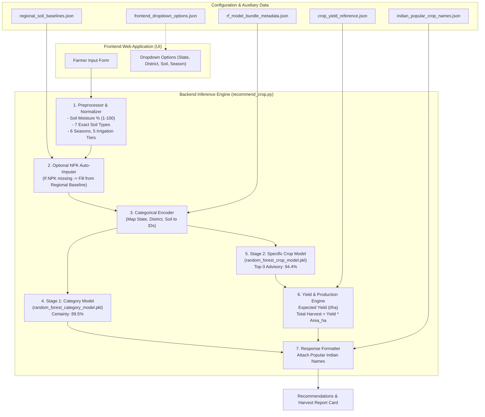

# 🌾 Indian National Crop Recommendation & Harvest Yield System
## Comprehensive System Architecture & Project Implementation Plan

---

## 1. Executive Summary & Architecture Overview

This project is a **Two-Stage Machine Learning Agricultural Recommendation and Harvest Production System** tailored for Indian farming conditions. It enables farmers, agronomists, and digital agriculture platforms to input regional, climatic, soil, and landholding parameters to receive:
1. **Stage 1 (Agricultural Domain / Family)**: Predicts the broad crop category (`Pulse`, `Cereal`, `Oilseed`, `Spice`, `Horticulture`, etc.) with **89.51% certainty**.
2. **Stage 2 (Specific Crop Recommendations)**: Predicts ranked specific crops with confidence percentages (**94.43% Top-3 advisory accuracy**, **98.19% Top-5 advisory accuracy**).
3. **Harvest Yield & Production Calculator**: Predicts the **Expected Yield (Tonnes/ha)** and the **Total Harvest Production (Tonnes)** tailored to the farmer's specific landholding area in hectares.
4. **Intelligent Baseline Imputation**: Allows farmers to omit soil nutrient measurements (NPK). If unknown, the system automatically pulls regional state/district agro-soil baselines.
5. **Cultural Name Localization**: Translates formal botanical and English dataset labels into popular, everyday Indian terminology (e.g. *Moth* $\rightarrow$ *Moth Bean / Matki*, *Arecanut* $\rightarrow$ *Betel Nut / Supari*, *Gram* $\rightarrow$ *Chickpea / Chana*).

---

## 2. Complete File Inventory & Purpose Matrix

The project directory contains **15 core files**, categorized by their role in the end-to-end system:

| File Name | Size | Role | Is it Needed in Web App? | Purpose in the Project |
| :--- | :---: | :---: | :---: | :--- |
| **`random_forest_crop_model.pkl`** | 2.59 GB | **ML Model** | **YES (Mandatory)** | **Stage 2 Specific Crop Model**: Pre-trained 200-tree Random Forest classifier predicting probabilities across **50 Indian crops**. |
| **`random_forest_category_model.pkl`** | 95.1 MB | **ML Model** | **YES (Recommended)** | **Stage 1 Domain Model**: Pre-trained 100-tree Random Forest classifier predicting probabilities across **10 crop categories** (89.5% certainty). |
| **`rf_model_bundle_metadata.json`** | 19.2 KB | **Config / Encoders** | **YES (Mandatory)** | **Model Encoders & Architecture**: Stores the exact 13 input feature column order, class labels, and integer string-to-ID categorical mappings. |
| **`crop_yield_reference.json`** | 916 KB | **Database** | **YES (Mandatory)** | **Harvest Production Engine**: Hierarchical database of historical crop yields (Tonnes/ha) by District $\rightarrow$ State $\rightarrow$ National. Multiplied by Field Area to calculate Total Harvest Tonnes. |
| **`regional_soil_baselines.json`** | 110 KB | **Database** | **YES (Mandatory)** | **NPK Auto-Imputation**: Contains baseline Nitrogen (N), Phosphorus (P), Potassium (K), pH, and Moisture for all 33 Indian States and 652 Districts. |
| **`indian_popular_crop_names.json`** | 2.0 KB | **Localization** | **YES (Recommended)** | **User Experience**: Maps all 50 technical dataset crop names to popular Indian names (e.g. *Bikaneri Bhujia Matki*, *Toor Dal*, *Sarson*, *Kapas*). |
| **`frontend_dropdown_options.json`** | 28.5 KB | **UI Schema** | **YES (Recommended)** | **Frontend Contract**: Pre-compiled dropdown options for UI (33 states, 652 districts mapped per state, 7 soils, 6 seasons, 5 irrigation tiers, and valid numeric ranges). |
| **`recommend_crop.py`** | 18.2 KB | **Backend Service** | **YES (Mandatory)** | **Core Recommendation Engine**: Production-ready Python module with CLI and importable `recommend()` function. Connects models and JSON files. |
| **`try_crop_model.py`** | 24.7 KB | **Testing Tool** | Optional (Dev/Test) | **Interactive Terminal Tool**: Interactive testing menu with 5 presets, random test sampling from real farms, and guided custom farm entry. |
| **`crop_ml_train.csv`** | 51.8 MB | **Dataset** | No (Training only) | **70% Training Split**: 157,163 historical field records used to train the models. Keep for audit and retraining. |
| **`crop_ml_test.csv`** | 22.2 MB | **Dataset** | Optional (Dev/Test) | **30% Held-out Split**: 67,356 fields used for model validation and live real-farm simulation in `try_crop_model.py`. |
| **`india_crop_final_ready_for_ml.csv`**| 74.1 MB | **Dataset** | No (Training only) | **Master Enriched Dataset**: Complete 224,519 record cleaned dataset. Keep as the authoritative data source. |
| **`dataset_dictionary.json`** | 1.9 KB | **Documentation** | No (Reference) | Schema definition of the 13 feature columns, 5 categorical columns, and target fields. |
| **`train_random_forest.py`** | 6.3 KB | **ML Pipeline** | No (Training only) | Standalone training script to re-train the models from `crop_ml_train.csv` if new data arrives. |
| **`RANDOM_FOREST_MODEL_REPORT.md`** | 20.6 KB | **Documentation** | No (Reference) | Formal project report with complete confusion matrices, accuracy benchmarks, and architecture justification. |

---

## 3. System Architecture & Component Interaction



---

## 4. How the Files Attach to the Two Models

### Component A: Stage 1 Category Model (`random_forest_category_model.pkl`)
- **Input**: 13 encoded numeric features.
- **Output**: Probabilities across 10 agricultural families (`Pulse`, `Cereal`, `Oilseed`, `Spice`, `Fiber`, `Horticulture_Vegetable`, `Horticulture_Fruit`, `Commercial_Plantation`, `Sugar_Crop`, `Other_Field_Crop`).
- **Files Attached**:
  - `rf_model_bundle_metadata.json` $\rightarrow$ Provides the list of category names and categorical encoders.
- **Why it matters**: Provides the overarching agricultural domain certainty. If the farmer asks *"Can I grow pulses this Rabi?"*, this model answers with 85%+ certainty.

---

### Component B: Stage 2 Specific Crop Model (`random_forest_crop_model.pkl`)
- **Input**: Exact same 13 encoded numeric features (including mandatory `Cultivated_Area_ha`).
- **Output**: Probability distribution across **50 Indian crops**.
- **Files Attached**:
  - `rf_model_bundle_metadata.json` $\rightarrow$ Provides feature order and the 50 crop class names.
  - `crop_yield_reference.json` $\rightarrow$ Attached to the top predicted crops to look up district/state historical yields (`Tonnes/ha`) and calculate total harvest (`Tonnes`).
  - `indian_popular_crop_names.json` $\rightarrow$ Attached to output labels to display familiar names like `Toor Dal / Arhar` instead of `Arhar/Tur`.
- **Why it matters**: Gives the farmer the exact ranked basket of suitable crops, their confidence score, expected yield per hectare, and total metric tonnes harvest for their land.

---

### Component C: The Pre-Inference Support Files
1. **`regional_soil_baselines.json`**:
   - **Where it attaches**: Attached before model inference.
   - **Role**: If a farmer doesn't know their soil test values for Nitrogen (N), Phosphorus (P), or Potassium (K), the system looks up their `State` and `District` in this file and fills the exact scientific baseline.
2. **`frontend_dropdown_options.json`**:
   - **Where it attaches**: Attached to the client-side frontend or API `/options` endpoint.
   - **Role**: When a user selects *Punjab*, the district dropdown dynamically populates with Punjab's districts. Also populates the 7 exact soil types and 6 seasons without hardcoding.

---

## 5. Input Features Specification (13 Parameters)

The system accepts exactly **13 pre-sowing parameters**:

| # | Feature Name | Type | Unit / Options | Is it Mandatory? | How Missing Values are Handled |
| :-: | :--- | :---: | :--- | :-: | :--- |
| **1** | `State` | Categorical | 33 Indian States / UTs | **Mandatory** | Selected from dropdown |
| **2** | `District` | Categorical | 652 Indian Districts | **Mandatory** | Dynamically filtered by State |
| **3** | `Crop_Season` | Categorical | `Kharif`, `Rabi`, `Summer`, `Whole Year`, `Autumn`, `Winter` | **Mandatory** | Selected from dropdown |
| **4** | `Soil_Type` | Categorical | 7 exact dataset soil categories: `Alluvial plains (proxy)`, `Arid/desert soil (proxy)`, `Black cotton/regur (proxy)`, `Coastal/lateritic mix (proxy)`, `Deltaic/alluvial (proxy)`, `Mountain/forest soil (proxy)`, `Red/red-yellow soil (proxy)` | **Mandatory** | Selected from dropdown |
| **5** | `Cultivated_Area_ha` | Numeric | Hectares (e.g. 1.0, 2.5, 5.0) | **Mandatory** | Essential for crop suitability and harvest output |
| **6** | `Rainfall_mm` | Numeric | Millimeters (typical: 100 to 2500 mm) | **Mandatory** | Seasonal expected rainfall |
| **7** | `Average_Temperature_C` | Numeric | Degrees Celsius (typical: 10 to 45 °C) | **Mandatory** | Seasonal average temperature |
| **8** | `Irrigation_Availability` | Categorical | `High (proxy)`, `Moderate–high (proxy)`, `Moderate (proxy)`, `Low–moderate (proxy)`, `Low/variable; likely rain-fed (proxy)` | **Mandatory** | Selected from dropdown |
| **9** | `Soil_Moisture_pct` | Numeric | Percentage from **1 to 100%** (dataset range: 12% to 48%) | **Mandatory** | Default: `25.0%` (Auto-scaled if entered as decimal) |
| **10** | `Soil_pH` | Numeric | pH scale (typical: 4.5 to 8.5) | **Mandatory** | Default: `7.0` |
| **11** | `Nitrogen_N` | Numeric | kg/ha (typical: 10 to 300) | **OPTIONAL** | If blank/0, auto-filled from `regional_soil_baselines.json` |
| **12** | `Phosphorus_P` | Numeric | kg/ha (typical: 5 to 100) | **OPTIONAL** | If blank/0, auto-filled from `regional_soil_baselines.json` |
| **13** | `Potassium_K` | Numeric | kg/ha (typical: 10 to 300) | **OPTIONAL** | If blank/0, auto-filled from `regional_soil_baselines.json` |

---

## 6. Minimal Production Code Implementation

Here is the complete, self-contained Python service ([`recommend_crop.py`](file:///e:/Downloads/india_crop_proxy_enrichment_package/recommend_crop.py)) showing how to load the models and files to generate predictions in a web backend (e.g. Flask, FastAPI, or Django):

```python
import os
import json
import pickle
import numpy as np
import pandas as pd

BASE_DIR = os.path.dirname(os.path.abspath(__file__))

# 1. Load Models & Metadata Once on Server Startup
with open(os.path.join(BASE_DIR, "random_forest_crop_model.pkl"), "rb") as f:
    crop_model = pickle.load(f)
with open(os.path.join(BASE_DIR, "random_forest_category_model.pkl"), "rb") as f:
    cat_model = pickle.load(f)
with open(os.path.join(BASE_DIR, "rf_model_bundle_metadata.json"), "r", encoding="utf-8") as f:
    meta = json.load(f)
with open(os.path.join(BASE_DIR, "crop_yield_reference.json"), "r", encoding="utf-8") as f:
    yield_data = json.load(f)
with open(os.path.join(BASE_DIR, "regional_soil_baselines.json"), "r", encoding="utf-8") as f:
    baseline_data = json.load(f)
with open(os.path.join(BASE_DIR, "indian_popular_crop_names.json"), "r", encoding="utf-8") as f:
    popular_names = json.load(f)


def get_baseline(state, district):
    """Retrieve regional NPK baselines if omitted by user."""
    dist_key = f"{state}|{district}"
    if dist_key in baseline_data.get("district_baselines", {}):
        return baseline_data["district_baselines"][dist_key]
    return baseline_data.get("state_baselines", {}).get(state, baseline_data["national_baseline"])


def get_harvest(state, district, crop_name, area_ha):
    """Calculate yield (t/ha) and total harvest (tonnes)."""
    dist_key = f"{state}|{district}|{crop_name}"
    state_key = f"{state}|{crop_name}"
    y_val = yield_data.get("district_yield", {}).get(dist_key)
    if y_val is None:
        y_val = yield_data.get("state_yield", {}).get(state_key, yield_data.get("national_crop_yield", {}).get(crop_name, 2.0))
    y_ha = round(float(y_val), 2)
    return y_ha, round(y_ha * area_ha, 2)


def predict_crop_recommendation(field_input: dict, top_k: int = 5):
    """Complete Two-Stage End-to-End Prediction Pipeline."""
    state = field_input.get("State", "")
    district = field_input.get("District", "")
    area_ha = float(field_input.get("Cultivated_Area_ha", 2.5))
    
    # Auto-impute optional NPK
    base = get_baseline(state, district)
    n = field_input.get("Nitrogen_N") or base["Nitrogen_N"]
    p = field_input.get("Phosphorus_P") or base["Phosphorus_P"]
    k = field_input.get("Potassium_K") or base["Potassium_K"]

    # Normalize Soil Moisture (1-100 scale)
    moist = float(field_input.get("Soil_Moisture_pct", 25.0))
    if 0 < moist <= 1.0:
        moist = moist * 100.0

    # Build input feature vector in exact order
    row_data = {
        "State": state, "District": district,
        "Crop_Season": field_input.get("Crop_Season", "Kharif"),
        "Soil_Type": field_input.get("Soil_Type", "Alluvial plains (proxy)"),
        "Cultivated_Area_ha": area_ha,
        "Rainfall_mm": float(field_input.get("Rainfall_mm", 650.0)),
        "Average_Temperature_C": float(field_input.get("Average_Temperature_C", 26.5)),
        "Irrigation_Availability": field_input.get("Irrigation_Availability", "High (proxy)"),
        "Soil_Moisture_pct": moist,
        "Soil_pH": float(field_input.get("Soil_pH", 7.0)),
        "Nitrogen_N": float(n), "Phosphorus_P": float(p), "Potassium_K": float(k)
    }

    # Encode categorical features
    encoded_vals = []
    features = meta["feature_columns"]
    cat_mappings = meta["categorical_mappings"]

    for feat in features:
        val = row_data[feat]
        if feat in cat_mappings:
            code = cat_mappings[feat].get(str(val), -1)
            encoded_vals.append(code if code != -1 else 0)
        else:
            encoded_vals.append(float(val))

    x_input = pd.DataFrame([encoded_vals], columns=features)

    # Stage 1: Category Prediction
    cat_probs = cat_model.predict_proba(x_input)[0]
    cat_classes = meta["crop_categories"]
    top_cat_idx = np.argsort(cat_probs)[::-1][:3]
    stage1_results = [
        {"category": cat_classes[i], "confidence_pct": round(float(cat_probs[i]) * 100.0, 2)}
        for i in top_cat_idx
    ]

    # Stage 2: Specific Crop Prediction with Harvest Yield
    crop_probs = crop_model.predict_proba(x_input)[0]
    crop_classes = meta["crop_classes"]
    top_crop_idx = np.argsort(crop_probs)[::-1][:top_k]
    
    stage2_results = []
    for rank, i in enumerate(top_crop_idx, 1):
        raw_crop = crop_classes[i]
        conf = round(float(crop_probs[i]) * 100.0, 2)
        y_ha, total_harvest = get_harvest(state, district, raw_crop, area_ha)
        stage2_results.append({
            "rank": rank,
            "crop_name": raw_crop,
            "popular_indian_name": popular_names.get(raw_crop, raw_crop),
            "confidence_pct": conf,
            "expected_yield_tonnes_per_ha": y_ha,
            "expected_total_harvest_tonnes": total_harvest
        })

    return {
        "status": "success",
        "farm_summary": {
            "location": f"{district}, {state}",
            "cultivated_area_ha": area_ha,
            "season": row_data["Crop_Season"],
            "soil_type": row_data["Soil_Type"],
            "soil_moisture_pct": moist,
            "npk_used": {"N": n, "P": p, "K": k, "source": "Custom" if field_input.get("Nitrogen_N") else "Regional Baseline"}
        },
        "stage1_domain": stage1_results,
        "stage2_recommendations": stage2_results
    }
```

---

## 7. Web API Request & Response Specification

### A. HTTP Request Payload (`POST /api/recommend`)
```json
{
  "State": "Punjab",
  "District": "Ludhiana",
  "Crop_Season": "Kharif",
  "Soil_Type": "Alluvial plains (proxy)",
  "Cultivated_Area_ha": 2.5,
  "Rainfall_mm": 680.0,
  "Average_Temperature_C": 31.0,
  "Irrigation_Availability": "High (proxy)",
  "Soil_Moisture_pct": 32.0,
  "Soil_pH": 7.2,
  "Nitrogen_N": null,
  "Phosphorus_P": null,
  "Potassium_K": null
}
```

### B. HTTP Response Payload
```json
{
  "status": "success",
  "farm_summary": {
    "location": "Ludhiana, Punjab",
    "cultivated_area_ha": 2.5,
    "season": "Kharif",
    "soil_type": "Alluvial plains (proxy)",
    "soil_moisture_pct": 32.0,
    "npk_used": { "N": 130.0, "P": 50.0, "K": 40.0, "source": "Regional Baseline" }
  },
  "stage1_domain": [
    { "category": "Cereal", "confidence_pct": 86.42 },
    { "category": "Pulse", "confidence_pct": 9.15 },
    { "category": "Oilseed", "confidence_pct": 3.20 }
  ],
  "stage2_recommendations": [
    {
      "rank": 1,
      "crop_name": "Rice",
      "popular_indian_name": "Rice / Paddy (Dhan / Chawal)",
      "confidence_pct": 72.18,
      "expected_yield_tonnes_per_ha": 4.12,
      "expected_total_harvest_tonnes": 10.30
    },
    {
      "rank": 2,
      "crop_name": "Maize",
      "popular_indian_name": "Maize / Corn (Makka)",
      "confidence_pct": 14.50,
      "expected_yield_tonnes_per_ha": 3.85,
      "expected_total_harvest_tonnes": 9.63
    },
    {
      "rank": 3,
      "crop_name": "Moong(Green Gram)",
      "popular_indian_name": "Green Gram / Moong Dal",
      "confidence_pct": 7.20,
      "expected_yield_tonnes_per_ha": 0.88,
      "expected_total_harvest_tonnes": 2.20
    }
  ]
}
```

---

## 8. Deployment Checklist for Your Web App

To deploy your crop recommendation web application on a server (e.g. AWS, Render, Heroku, VPS, or local server), **copy only these 7 core files** into your backend app directory:

1. 📄 **`recommend_crop.py`** *(Inference logic & API service)*
2. 📦 **`random_forest_crop_model.pkl`** *(Core 50-crop classifier)*
3. 📦 **`random_forest_category_model.pkl`** *(Stage 1 category classifier)*
4. ⚙️ **`rf_model_bundle_metadata.json`** *(Feature schema and encoders)*
5. 📊 **`crop_yield_reference.json`** *(Yield & total harvest calculation)*
6. 🧪 **`regional_soil_baselines.json`** *(Optional NPK auto-imputation)*
7. 🌐 **`indian_popular_crop_names.json`** *(Popular names dictionary)*
8. 📋 **`frontend_dropdown_options.json`** *(Send to frontend for dropdown menus)*

> [!TIP]
> **Dataset Files (`crop_ml_train.csv`, `crop_ml_test.csv`, `india_crop_final_ready_for_ml.csv`)** do NOT need to be uploaded to your web production server. They are only needed if you retrain the models in the future using [`train_random_forest.py`](file:///e:/Downloads/india_crop_proxy_enrichment_package/train_random_forest.py).
